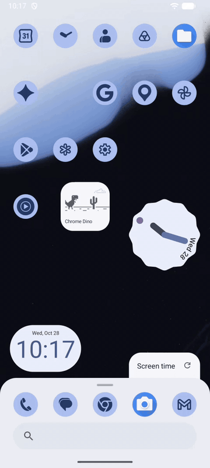
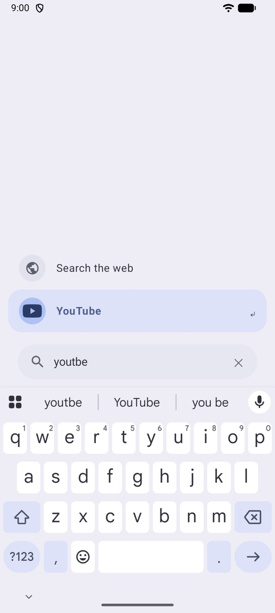
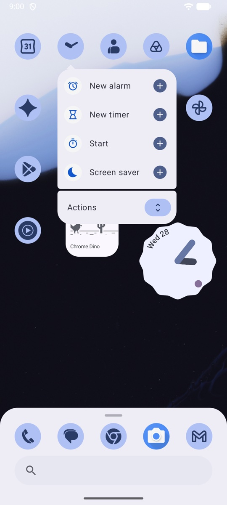
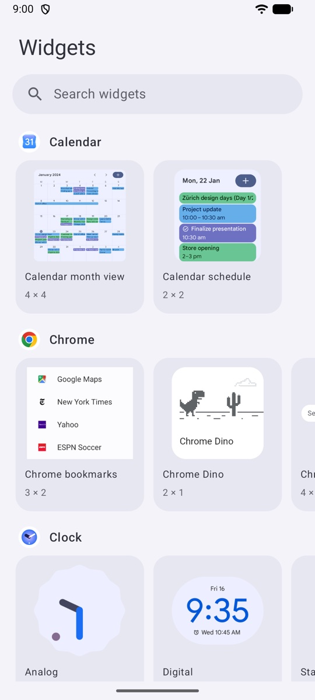

# Foyer

An Android home screen that stays where you put it.

<table>
  <tr>
    <td></td>
    <td></td>
    <td></td>
    <td></td>
  </tr>
  <tr>
    <td align="center">Scrolling feed</td>
    <td align="center">Search with a typo</td>
    <td align="center">Shortcuts</td>
    <td align="center">Widgets</td>
  </tr>
</table>

- Home is one long feed of apps and widgets. Scroll it up and down like a web page.
- Apps and widgets stay in the cell you put them in. Foyer never sorts, suggests or adds anything.
- Pull up the dock and type. Search finds the app with typos, the wrong keyboard layout or a Russian spelling.
- Foyer has no internet permission, no account and no tracking.
- Colors come from your wallpaper, like on a Pixel.

## Install

Foyer needs Android 12 or later.

1. Download the APK from the [latest release](https://github.com/slopworks-org/foyer/releases/latest) and install it.
2. Open Settings > Apps > Default apps > Home app and select Foyer.

To build from source, run `./gradlew :app:installRelease`. A local build is signed with your debug key, so it cannot update a release build.

Gestures

- Pull down at the top of the home screen to open the notifications.
- Pull up the dock, or tap the search bar, to open search.
- Press Enter to open the first result. To search the web, tap "Search the web".
- Long-press an app to see its shortcuts and actions. Tap `+` to pin a shortcut.
- Long-press an item and drag it to move it.
- Long-press a widget, then drag a handle of its frame to resize it.
- Long-press an empty area to add widgets or open settings.
- To make a folder, drag an app onto the center of a desktop app and hold as it becomes a two-icon folder, then release. The unnamed folder stays closed at the target’s position, with the target first. Empty folders disappear automatically; a folder with one app keeps its identity and appearance. Releasing over the center before the folder is ready returns the app unchanged. The surrounding cell allows swapping; after leaving a recognized center, pause briefly before releasing to swap. Search copies an app; desktop and folder sources move one icon. TalkBack offers “Combine with …” on apps.
- Drag an app from search or the desktop onto a folder. Desktop apps move into it. Hold over a small folder to open it, then drop over a member to insert before it. Long-press a member and drag to reorder, move to another folder, or move out to a free desktop cell or dock slot. The same app can appear more than once; each copy can be launched, reordered, dragged or removed independently. Long-press a member and choose Remove to remove just that copy. Invalid drops leave the source unchanged.
- Tap a small folder to open its anchored grid; tap the name below the apps to rename it, or clear it to hide the desktop title. Tap outside, Back or Home to close. Long-press the folder background (between icons in a large folder), then drag to move the whole folder. Its Actions menu offers Enlarge folder / Shrink folder and Remove.
- Small folders open a scrolling app grid. Large folders occupy 2 × 2 cells and launch up to nine app copies directly. Their nine positions stay fixed when an app is removed; shrinking and enlarging pack the remaining copies in occupied order. Expansion needs free cells beside and below the folder; it never moves neighbors. Folders stay in the feed and may remain empty. With one app copy left, the folder becomes that app at its top-left cell; freed cells stay empty. Adding the first app to an empty folder also turns it into a regular app.

How search works

Search is a pure function in the `search/` module. It keeps no history and no usage statistics, so the same query always gives the same order.

Each query also matches with the keyboard layout swapped (`ntktuhfv` finds Telegram) and in Latin letters (`ютуб` finds YouTube). Search also finds app shortcuts (`tg мама`). To give an app other names, long-press the app and select "Aliases".

## License

[AGPL-3.0-or-later](LICENSE)
