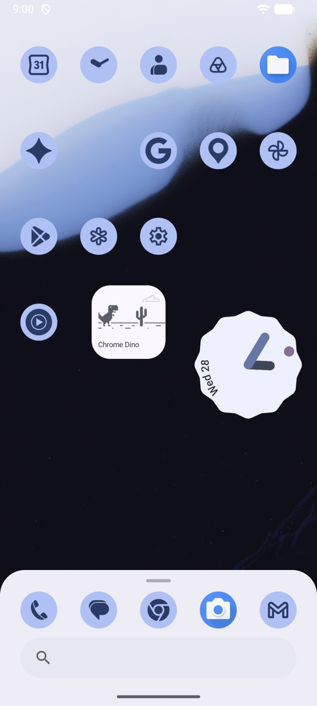
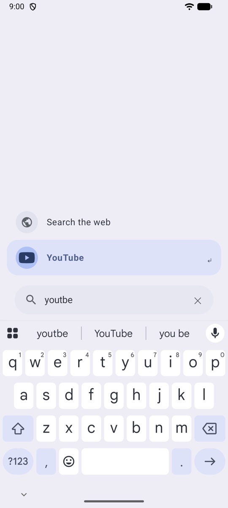
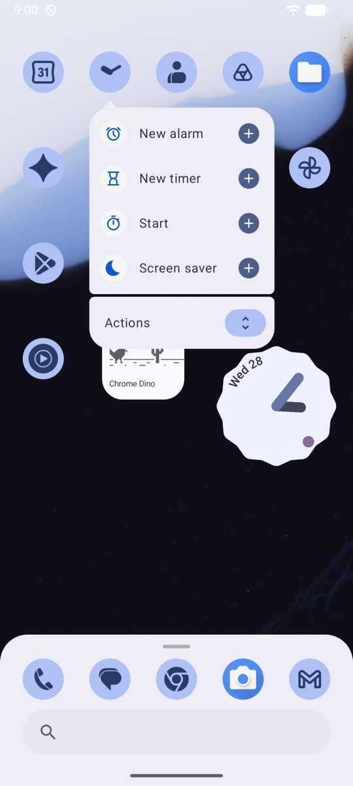
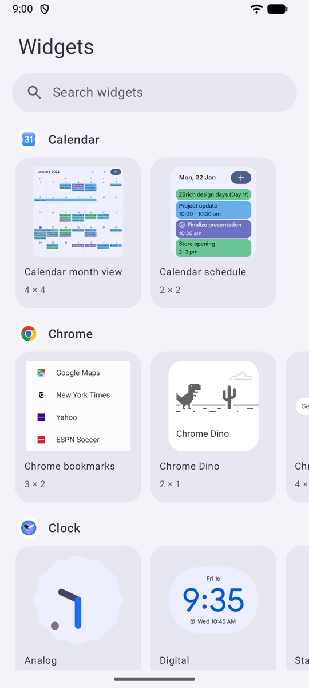

# Foyer

An Android home screen that stays where you put it.

<table>
  <tr>
    <td></td>
    <td></td>
    <td></td>
    <td></td>
  </tr>
  <tr>
    <td align="center">Home</td>
    <td align="center">Search with a typo</td>
    <td align="center">Shortcuts</td>
    <td align="center">Widgets</td>
  </tr>
</table>

- Apps and widgets stay in the cell you put them in. Foyer never sorts, suggests or adds anything.
- Pull up the dock and type. Search finds the app with typos, the wrong keyboard layout or a Russian spelling.
- Foyer has no internet permission, no account and no tracking.
- Colors come from your wallpaper, like on a Pixel.

## Install

Foyer needs Android 12 or later. There is no store release yet, so build it from source:

```sh
./gradlew :app:installRelease
```

Then open Settings > Apps > Default apps > Home app and select Foyer.

<details>
<summary>Gestures</summary>

- Pull down at the top of the home screen to open the notifications.
- Pull up the dock, or tap the search bar, to open search.
- Press Enter to open the first result. To search the web, tap "Search the web".
- Long-press an app to see its shortcuts and actions. Tap `+` to pin a shortcut.
- Long-press an item and drag it to move it.
- Long-press a widget, then drag a handle of its frame to resize it.
- Long-press an empty area to add widgets or open settings.

</details>

<details>
<summary>How search works</summary>

Search is a pure function in the `search/` module. It keeps no history and no usage statistics, so the same query always gives the same order.

Each query also matches with the keyboard layout swapped (`ntktuhfv` finds Telegram) and in Latin letters (`ютуб` finds YouTube). Search also finds app shortcuts (`tg мама`). To give an app other names, long-press the app and select "Aliases".

</details>

## License

[AGPL-3.0-or-later](LICENSE)
